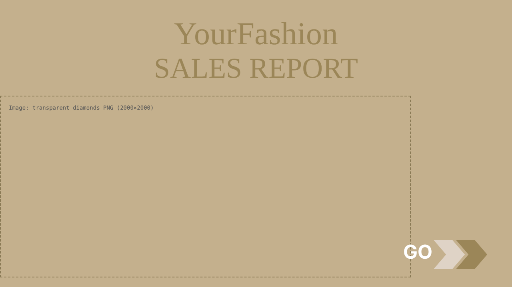
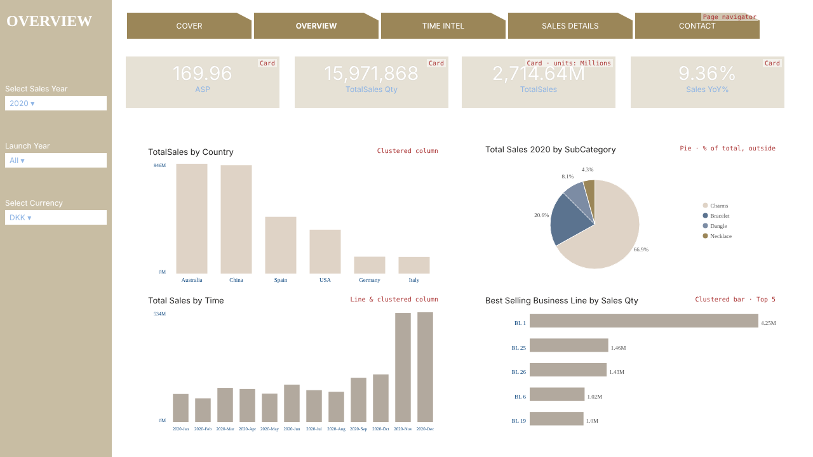
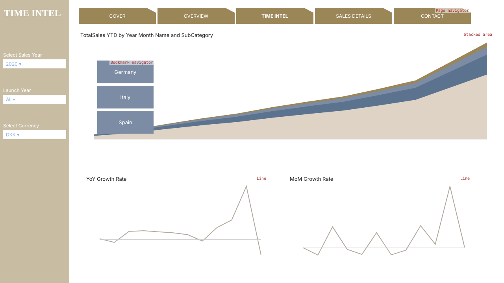
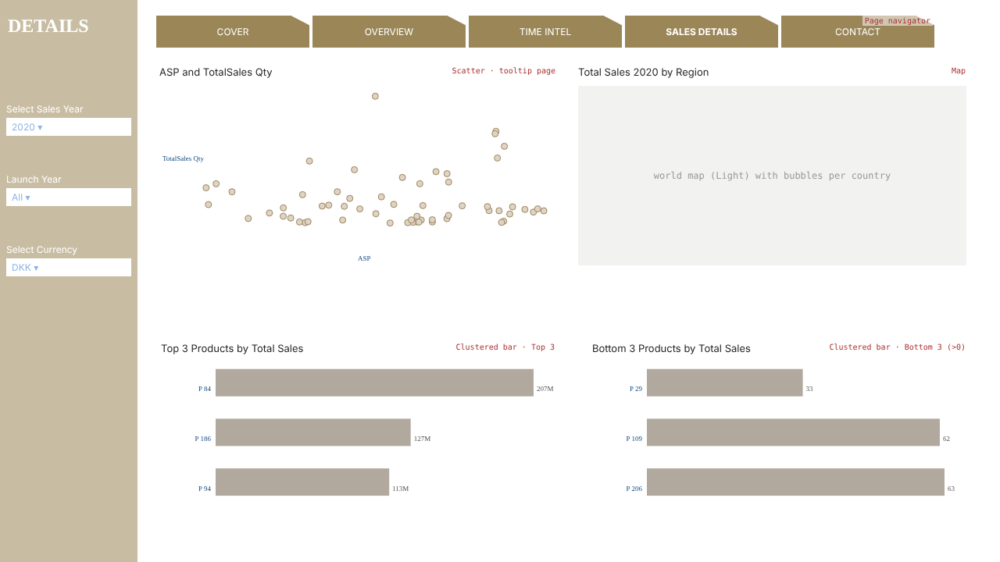
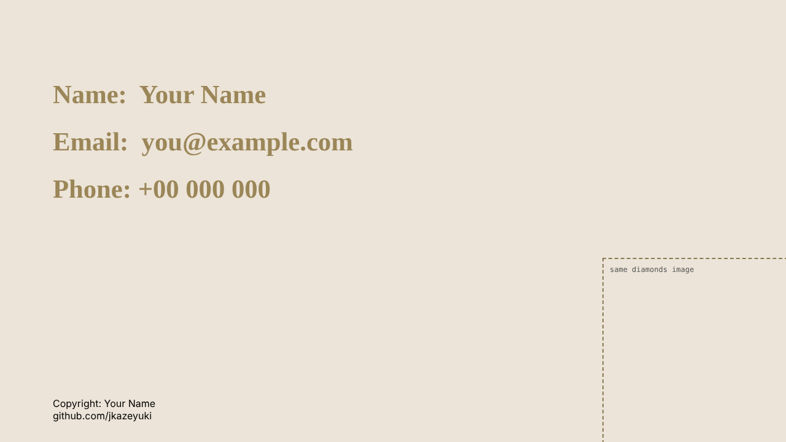
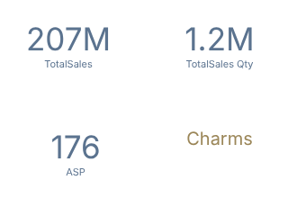

# Make Your Report Look Exactly Like the Solution

This guide reproduces the **look** of `PowerBI_Case_3_Final_solution - Sales Analysis.pbix` page by
page: positions, sizes, colours, fonts and settings. All of it comes from the solution file's layout.
It replaces the styling parts of Day 2 in [DAY_BY_DAY.md](DAY_BY_DAY.md) (Steps 2.4–2.8). Do Day 1 and
the measures (Steps 2.1–2.3) first, because the visuals need the model and measures in place.

**Reference pictures** of each page are in [`design/`](design/). They show where everything goes, the
colours and the field each visual uses. The charts are drawn with the real 2020 DKK numbers. The red
labels in the corners are notes for you, not part of the report.

| | |
|---|---|
|  |  |
|  |  |
|  |  |

---

## Step 0: Get the three things you need (15 min)

1. **The theme file:** [`design/yourfashion_theme.json`](design/yourfashion_theme.json). Download it
   (*Raw* button on GitHub → right-click → Save as) into `C:\Case3\`.
   It contains the solution's colours, so the colour picker positions below match.
2. **The diamond image** used on the cover and contact pages. It's stored inside the solution file:
   1. Copy `PowerBI_Case_3_Final_solution - Sales Analysis.pbix` and rename the copy to `solution.zip`.
   2. Open the zip → `Report` → `StaticResources` → `RegisteredResources`.
   3. Copy the `.png` file (about 1.2 MB, diamonds on a transparent background) to `C:\Case3\diamonds.png`.
3. **The solution file open on the side** (optional): open it in a second Power BI window and compare
   as you go. If it asks to refresh, click *Cancel*. The data is stored in the file, so it still displays.

### How to set an exact position and size
Select a visual → **Format** pane (paintbrush icon) → **General** tab → **Properties** →
**Size** (Height, Width) and **Position** (Horizontal = X, Vertical = Y). Type the numbers in this
guide. Every position is listed as **X, Y, W × H** in pixels.

### The colour palette
After importing the theme, these colours appear in every colour picker under *Theme colors*.
You can also type the hex code under *More colors*.

| Name used below | Hex | Used for |
|---|---|---|
| **White** | `#FFFFFF` | Page background, slicer headers, card values, navigator text |
| **Gold** | `#9B8658` | Sidebar, page tabs, cover/contact text |
| **Tan** | `#C4B08D` | Cover background |
| **Cream** | `#ECE4D8` | Contact background |
| **Beige** | `#DFD3C6` | Default chart colour (1st data colour) |
| **Dark beige** | `#B2A99E` | Bars and lines (beige, 20% darker) |
| **Slate blue** | `#5B738F` | Tooltip page values |
| **Blue-grey** | `#7C8CA4` | Bookmark buttons |
| **Navy** | `#114A81` | Axis labels |
| **Light blue** | `#8FB5E5` | Slicer values, card labels (theme foreground, 40% lighter) |

Fonts: titles are **Times New Roman**; everything else uses the default **Segoe UI**.

---

## Step 1: Report setup (10 min)

1. `View → Themes → Browse for themes` → `yourfashion_theme.json` → *Open*.
   🔎 Your pie or column charts turn beige / slate / gold.
2. For every page: `Format page` (click empty canvas) → **Canvas settings** → Type **16:9** (1280 × 720).
3. Pages, in this order: `COVER`, `OVERVIEW`, `TIME INTEL`, `SALES DETAILS`, `CONTACT`, `ProductTooltip`.
   Rename a page by double-clicking its tab.

Build **OVERVIEW first**. Its sidebar, title, navigator and slicers are copied to the next two pages.

---

## Step 2: OVERVIEW (90 min)

### 2.1 Page background
`Format page → Canvas background` → Color **White**, Transparency **0%**.
`Wallpaper` → Color **White**.

### 2.2 Sidebar (left gold strip)
`Insert → Shapes → Rectangle` → **0, 0, 176 × 720**.
Format → **Shape → Style**: Fill **Gold**, Transparency **45%**. **Border: Off**.
Right-click it → **Send to back**, so slicers placed on top stay clickable.

### 2.3 Page title
`Insert → Text box` → **10, 20, 221 × 41**. Type `OVERVIEW`, select the text → **Times New Roman, 18,
Bold, White**. Format → **Effects → Background: Off**.

### 2.4 Page navigator (gold tabs)
`Insert → Buttons → Navigator → Page navigator` → **198, 16, 1000 × 49**.
Format → **Visual**:
- **Shape** → *Tab, cut corner*.
- **Style** → (State: Default) **Fill**: **Gold**, Transparency 0%. **Text**: Font color **White**.
- **Pages** → *Show hidden pages*: **Off**.
- **General → Effects**: Shadow **Off**, Visual border **Off**.

It creates one tab per visible page. Hide `ProductTooltip` later (Step 7) and it disappears from the tabs.
The solution also has a scratch page called "Page 1" that shows as a sixth tab; don't create it.

### 2.5 Three slicers (in the sidebar)

| Slicer | Field | Position | Header text |
|---|---|---|---|
| Year | `DimDate[Year]` | **0, 130, 176 × 60** | `Select Sales Year` |
| Launch year | `DimProduct[Launch Year]` | **0, 220, 176 × 60** | `Launch Year` |
| Currency | `DimCurrency[Currency]` | **0, 310, 176 × 60** | `Select Currency` |

Format each one the same way:
- **Visual → Slicer settings → Options → Style: Dropdown**.
- **Selection → Single select: On** (Year and Currency only).
- **Slicer header** → Title text as in the table, Font color **White**.
- **Values** → Font color **Light blue** `#8FB5E5`, Background **White**.
- **General → Effects → Background: Off**.

Select **2020** and **DKK**.

> Tip: format the first slicer completely, then **Ctrl+C / Ctrl+V** it twice and swap the field
> (drag the new field onto the old one in the *Field* well). This keeps all formatting.

### 2.6 Four KPI cards
Use the classic **Card** visual (not *Card (new)*). Positions, all **242 × 81**:

| Card | Field | X, Y | Extra |
|---|---|---|---|
| 1 | `ASP` | **198, 89** | |
| 2 | `TotalSales Qty` | **464, 89** | |
| 3 | `TotalSales` | **727, 89** | Callout value → Display units **Millions** |
| 4 | `Sales YoY%` | **993, 89** | |

Format each:
- **Visual → Callout value**: Font size **30**, Color **White**.
- **Category label**: Font size **10**, Color **Light blue** `#8FB5E5`.
- **General → Effects → Background**: Color **Gold**, Transparency **75%**. Visual border **Off**.

> The solution's white numbers on a pale gold card are hard to read. To keep the look but make the
> numbers readable, use Callout value colour **Gold** `#9B8658` instead of white. It's your choice;
> interviewers notice readability.

### 2.7 Currency note
The solution has a text box *"Please note the selected currency by default is DKK"* in **bold white**
at 927, 89, behind the 4th card. That makes it invisible. Put it where it can be read: **8, 380, 160 × 60**
in the sidebar, Segoe UI **9**, **White**, Background **Off**.

### 2.8 Four charts
Shared chart style (the solution uses it on all bar and line charts; apply it to each):
- **General → Title**: the title text from the table, Heading *Normal*.
- **General → Effects**: Background **Off**, Visual border **Off**.
- **X axis**: Title **Off**, Values color **Navy** `#114A81`, font size **8**.
- **Y axis**: Title **Off**, Values color **Navy**, font size **8**, Display units **Millions**,
  Value decimal places **1**. **Gridlines: Off**.
- **Bars / Columns / Lines** colour: **Dark beige** `#B2A99E`.

| Visual | Fields | X, Y, W × H | Title | Special settings |
|---|---|---|---|---|
| **Clustered column** | X: `DimBusinessLine[Country]`, Y: `TotalSales` | **227, 227, 470 × 233** | (default) | Keeps the theme's **Beige** columns; Y axis Millions; axis titles off. Sort by TotalSales, descending |
| **Pie** | Legend: `DimProduct[SubCategory]`, Values: `TotalSales` | **758, 223, 470 × 235** | `Total Sales 2020 by SubCategory` | **Detail labels** → Label contents *Percent of total*, Position *Outside*. **Legend** → On, Position *Right center*. Slice colours = theme defaults |
| **Line and clustered column** | X: `DimDate[Year Month Name]`, Column y-axis: `TotalSales` | **227, 461, 470 × 233** | `Total Sales by Time` | Shared style. Columns Dark beige |
| **Clustered bar** | Y: `DimBusinessLine[Business Line Name]`, X: `TotalSales Qty` | **758, 461, 470 × 233** | `Best Selling Business Line by Sales Qty` | Shared style. Filter: Business Line Name **Top N = 5** by `TotalSales Qty` |

🔎 **Compare** with `design/2_overview.png`: gold strip on the left, gold tabs on top, 4 pale gold cards,
beige column chart and pie top row, dark-beige bars bottom row.

### 2.9 Sync slicers
`View → Sync slicers`. Select each slicer and tick **sync** and **visible** for OVERVIEW, TIME INTEL and
SALES DETAILS. Do this again after Step 3 and Step 4 if the pages didn't exist yet.

---

## Step 3: TIME INTEL (45 min)

1. Right-click the OVERVIEW tab → **Duplicate page** → rename `TIME INTEL`.
2. Delete the 4 cards and the 4 charts. Keep the sidebar, navigator, slicers and note. Change the title
   text to `TIME INTEL`.
3. **Stacked area chart**: **198, 77, 1059 × 306**. X: `DimDate[Year Month Name]`, Y: `TotalSales YTD`,
   Legend: `DimProduct[SubCategory]`. Y axis Display units **Millions**, axis titles **Off**. Colours =
   theme defaults (Beige, Slate blue, Blue-grey, Gold).
4. **Line chart**: **213, 443, 470 × 235**. X: `Year Month Name`, Y: `Sales YoY%`. Title `YoY Growth Rate`.
   Apply the shared chart style, but on the **Y axis** set Display units **None** and
   **Range → Maximum 1.5** (150%). Line colour **Dark beige**.
5. **Line chart**: **730, 443, 470 × 235**. The same with `Sales MoM%`, titled `MoM Growth Rate`.
   (Copy-paste the YoY chart and swap the field.)
6. **Country bookmarks**: the steps are in [DAY_BY_DAY.md Step 2.6.5](DAY_BY_DAY.md#step-26-time-intel-page-45-min).
   Bookmarks named `Germany`, `Italy`, `Spain`, each saved with *Selected visuals* = the area chart.
7. **Bookmark navigator**: `Insert → Buttons → Navigator → Bookmark navigator` → **241, 148, 155 × 218**.
   It sits on top of the left part of the area chart, as in the solution.
   Format → **Grid layout → Orientation: Vertical**. **Style → Fill**: **Blue-grey** `#7C8CA4`.
   **Text**: **White**.

---

## Step 4: SALES DETAILS (45 min)

1. Duplicate TIME INTEL → rename `SALES DETAILS` → delete its charts and the bookmark navigator.
2. Change the title text to `DETAILS`. The tab name stays SALES DETAILS; the solution's sidebar title is shorter.
3. Navigator: set it to **198, 19, 1015 × 46**. The solution's is slightly different on this page; using
   **198, 16, 1000 × 49** like the other pages is fine too.
4. Visuals:

| Visual | Fields | X, Y, W × H | Title | Settings |
|---|---|---|---|---|
| **Scatter chart** | Values: `DimProduct[Product Name]`, X: `ASP`, Y: `TotalSales Qty` | **198, 80, 520 × 260** | `ASP and TotalSales Qty` | X and Y axis **titles On**. **General → Tooltips → Type: Report page, Page: ProductTooltip** (after Step 7) |
| **Map** | Location: `DimBusinessLine[Country]`, Legend: `DimProduct[SubCategory]`, Bubble size: `TotalSales` | **734, 80, 509 × 280** | `Total Sales 2020 by Region` | **Map settings → Style: Light**. **Bubbles → Size: 4** (small). **Legend: Off**. Background Off, Border Off |
| **Clustered bar** | Y: `Product Name`, X: `TotalSales` | **200, 434, 517 × 231** | `Top 3 Products by Total Sales` | Shared style. Filter **Top N = 3** by `TotalSales` |
| **Clustered bar** | Y: `Product Name`, X: `TotalSales` | **752, 434, 491 × 231** | `Bottom 3 Products by Total Sales` | Shared style. **Bottom N = 3** by `TotalSales`, plus a filter `TotalSales` *is greater than* 0 |

The solution's Bottom 3 has no "greater than 0" filter, so it shows products with zero sales. With the
filter, the chart shows real slow sellers. That's a better result and something to mention in an interview.

---

## Step 5: COVER (20 min)

1. **Background:** `Format page → Canvas background` → **Tan** `#C4B08D`, Transparency 0%.
2. **Title:** text box **0, 38, 1280 × 202**. Line 1 `YourFashion` in **Times New Roman 60**, line 2
   `SALES REPORT` in **Times New Roman 54**, both **Gold** `#9B8658`, centred. Background **Off**.
3. **Image:** `Insert → Image` → `diamonds.png` → **0, 240, 1023 × 452**.
4. **"GO" text:** text box **1008, 602, 99 × 87**, `GO`, **Segoe UI 36 Bold White**, Background **Off**.
5. **Two chevron arrows:** `Insert → Shapes → Chevron`:
   - Arrow 1: **1084, 602, 78 × 73**, Fill **Beige** `#DFD3C6`.
   - Arrow 2: **1140, 602, 78 × 73**, Fill **Gold** `#9B8658`.
   - Both: Border **Off**. **Action: On → Type: Page navigation → Destination: OVERVIEW**.
   🔎 **Ctrl+click** an arrow; it jumps to OVERVIEW.

---

## Step 6: CONTACT (10 min)

1. **Background:** **Cream** `#ECE4D8`.
2. **Details:** text box **86, 135, 665 × 225**. Three lines with an empty line between each:
   `Name:  …`, `Email:  …`, `Phone: …`. Use **Times New Roman 32 Bold Gold**. **Use your own details**:
   the solution has placeholders (ABC, abc@nordic-flipflop.com).
3. **Image:** `diamonds.png` → **981, 420, 299 × 299**.
4. **Footer:** text box **86, 647, 239 × 73**, Segoe UI **12**, **Black**: `Copyright: <your name>` and on
   the next line your GitHub or LinkedIn URL.

---

## Step 7: ProductTooltip page (15 min)

1. `Format page → Page information → Allow use as tooltip: On`; **Canvas settings → Type: Tooltip** (320 × 240).
2. Four **Card** visuals, each **152 × 120**:

| Card | Field | X, Y | Callout value | Category label |
|---|---|---|---|---|
| 1 | `TotalSales` | **0, 0** | **35**, **Slate blue** `#5B738F` | Slate blue |
| 2 | `TotalSales Qty` | **168, 0** | 35, Slate blue | Slate blue |
| 3 | `ASP` | **8, 120** | 35, Slate blue | Slate blue |
| 4 | `DimProduct[SubCategory]` → **First** | **168, 120** | **20**, **Gold** `#9B8658` | **Off** |

3. Drag `DimProduct[Product Name]` into the page's **Tooltip** well (Visualizations pane, nothing selected).
4. Right-click the tab → **Hide page**. It disappears from the page navigator.
5. On SALES DETAILS, select the scatter → **General → Tooltips → Type: Report page, Page: ProductTooltip**.
   🔎 Hover a dot: the 4-card tooltip appears.

---

## Step 8: Final comparison (15 min)

Put your report and the solution side by side and click through each page:
- [ ] Same 5 tabs on the navigator (COVER, OVERVIEW, TIME INTEL, SALES DETAILS, CONTACT), with no tooltip page or "Page 1".
- [ ] Slicers on all three report pages change together (sync slicers).
- [ ] With **2020 + DKK**, the cards show ASP **~170**, Qty **~15.97M**, TotalSales **~2,714.6M**, YoY **9.36%**.
- [ ] Bookmark buttons switch the area chart's country.
- [ ] Hovering the scatter shows the tooltip page.
- [ ] Cover arrows go to OVERVIEW.

Your totals differ from the solution's by about 0.003% because you removed the junk rows (see README §8).
That's intended, not a mistake.

### What not to copy from the solution
The solution file contains leftovers from earlier versions. Don't recreate them:
- **Hidden duplicate slicers** on each page (`Select Year` and `Currency`, plus an empty one). Check the
  solution's `View → Selection` pane: they have a crossed-out eye.
- **Per-category colours** that point to a table from another course ("Heartlake City", "LPP Concept").
  They have no effect.
- **"Page 1"**, a scratch page for checking the EUR conversion. Keep yours hidden.
